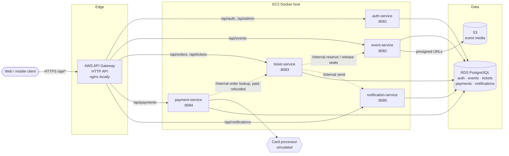
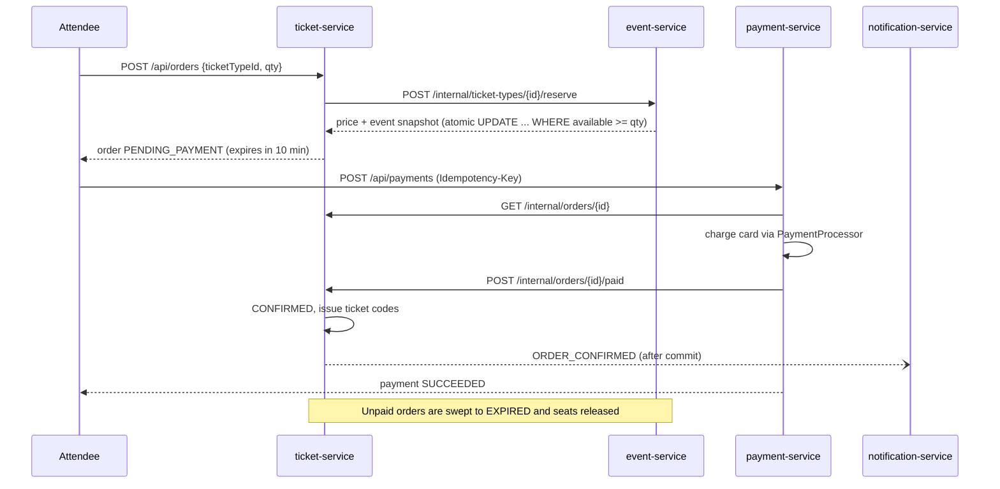

# TicketTide

An Eventbrite-style event ticketing platform built as **five Spring Boot microservices**
(auth, events, ticketing, payments, notifications). Services run as Docker containers on
**AWS EC2**, persist to **RDS PostgreSQL** (one database per service), store event cover
images in **S3**, and sit behind **API Gateway** for routing.

Organizers create events and ticket tiers, publish them, upload cover art and track sales.
Attendees browse upcoming events, reserve seats (held for 10 minutes), pay, and receive
single-use ticket codes that organizers scan at the door. Every step sends in-app (and
email) notifications.

## Architecture



Solid arrows are public traffic; dotted arrows are service-to-service calls on `/internal/**`
authenticated with a shared `X-Internal-Api-Key`. Neither API Gateway nor the local nginx
gateway has a route for `/internal/**`.

### Purchase flow



### Services

| Service | Responsibilities | Data |
|---|---|---|
| `auth-service` | Register / login (BCrypt), issues HS256 JWTs with `userId`, `email`, `role`; admin role management; bootstraps first admin | `users` |
| `event-service` | Event CRUD and lifecycle (DRAFT → PUBLISHED → CANCELLED), ticket tiers, search & paging, S3 cover uploads with presigned reads, sales report, seat inventory | `events`, `ticket_types` |
| `ticket-service` | Orders with price snapshot and seat hold, cancel, expiry sweeper, ticket issuance, attendee wallet, organizer check-in | `orders`, `tickets` |
| `payment-service` | Idempotent charges, simulated card processor, auto-refund if a hold lapses mid-payment, admin refunds | `payments` |
| `notification-service` | Internal send API, persisted inbox with unread count, async after-commit email dispatch via pluggable `EmailSender` | `notifications` |
| `common` | JWT verification, internal API-key filter, security defaults, RFC 7807 error handling, internal `RestClient` factory | — |

### Key design decisions

- **Stateless auth at the edge of each service.** Every service verifies the JWT locally with
  the shared secret, so no request fans out to auth-service.
- **No overselling without distributed locks.** Seat reservation is a single conditional
  `UPDATE ticket_types SET available = available - :qty WHERE id = :id AND available >= :qty`.
  A DB `CHECK (available BETWEEN 0 AND capacity)` is the last line of defence.
- **Compensation instead of distributed transactions.** If ticket-service fails to persist an
  order after reserving seats, it releases them. If a payment captures after the hold expired,
  payment-service refunds the charge automatically.
- **Idempotent payments.** `Idempotency-Key` is unique per user; a partial unique index ensures
  an order can only ever have one pending/succeeded payment regardless of key.
- **Optimistic locking on orders** lets several ticket-service instances run the expiry sweeper
  and race safely with late payments.
- **Side effects after commit.** Notifications are sent only once the order change is durable,
  and emails go out asynchronously so a slow mail provider never blocks checkout.

## API overview

All public routes are under the gateway (`http://localhost:8080` locally).

| Method & path | Who | Description |
|---|---|---|
| `POST /api/auth/register` | anyone | Register (`role`: `ATTENDEE` default or `ORGANIZER`) |
| `POST /api/auth/login` | anyone | Get a bearer token |
| `GET /api/auth/me` | signed in | Current profile |
| `PUT /api/admin/users/{id}/role` | admin | Change a user's role |
| `GET /api/events?q=&city=&category=&before=&page=&size=` | anyone | Search upcoming published events |
| `GET /api/events/{id}` | anyone | Event detail with ticket tiers |
| `GET /api/events/mine` | organizer | Organizer's own events |
| `POST /api/events`, `PUT /api/events/{id}` | organizer | Create / edit event |
| `POST /api/events/{id}/ticket-types` | organizer | Add a ticket tier |
| `POST /api/events/{id}/publish` · `/cancel` | organizer | Lifecycle |
| `POST /api/events/{id}/image` (multipart `file`) | organizer | Upload cover to S3 |
| `GET /api/events/{id}/sales` | organizer | Sold count and gross revenue per tier |
| `POST /api/orders` | signed in | Reserve seats `{ticketTypeId, quantity}` |
| `GET /api/orders`, `GET /api/orders/{id}` | owner | Order history / detail |
| `POST /api/orders/{id}/cancel` | owner | Release a pending reservation |
| `GET /api/tickets` | signed in | Ticket wallet |
| `POST /api/tickets/{code}/check-in` | organizer | Scan a ticket at the door |
| `POST /api/payments` + `Idempotency-Key` header | owner | Pay `{orderId, cardToken}` |
| `GET /api/payments`, `GET /api/payments/{id}` | owner | Payment history |
| `POST /api/payments/{id}/refund` | admin | Refund and void tickets |
| `GET /api/notifications?unreadOnly=` | signed in | Inbox |
| `GET /api/notifications/unread-count` | signed in | Badge count |
| `POST /api/notifications/{id}/read` · `/read-all` | signed in | Mark read |

**Test card tokens** (simulated processor): `tok_visa` (or any `tok_*`) succeeds;
`tok_declined`, `tok_insufficient_funds` and `tok_expired` are declined with HTTP 402.

## Project layout

```
TicketTide/
├── pom.xml                    # Maven parent (Java 21, Spring Boot 3.3)
├── common/                    # shared security + web utilities
├── auth-service/
├── event-service/
├── ticket-service/
├── payment-service/
├── notification-service/      # each: src/main/java, Flyway migrations, tests
├── Dockerfile                 # shared multi-stage build (--build-arg SERVICE=...)
├── docker-compose.yml         # Postgres, LocalStack S3, nginx gateway, 5 services
├── gateway/nginx.conf         # local mirror of the API Gateway route table
├── docker/                    # Postgres + LocalStack init scripts
├── infra/terraform/           # VPC, EC2, RDS, S3, ECR, SSM, API Gateway
└── scripts/                   # push-images.sh, smoke-test.sh
```

## Running locally

Requirements: Docker with Compose v2. (For running services outside Docker: JDK 21 and Maven 3.9.)

```bash
cp .env.example .env
# set JWT_SECRET (>= 32 bytes) and INTERNAL_API_KEY, e.g.
#   openssl rand -base64 48   and   openssl rand -hex 32

docker compose up --build
```

This starts PostgreSQL (with one database per service), LocalStack S3 (bucket created on
startup), the five services and the nginx gateway on **http://localhost:8080**. Flyway applies
each service's schema on boot. If `BOOTSTRAP_ADMIN_EMAIL` / `BOOTSTRAP_ADMIN_PASSWORD` are set,
an admin account is created on first start.

Quick check:

```bash
curl -s -X POST localhost:8080/api/auth/register \
  -H 'Content-Type: application/json' \
  -d '{"email":"org@example.com","password":"password123","fullName":"Org","role":"ORGANIZER"}'
```

Running a single service from source (with Postgres from compose):

```bash
docker compose up -d postgres localstack
export JWT_SECRET=... INTERNAL_API_KEY=...
mvn -pl event-service -am spring-boot:run
```

## Testing

Unit and slice tests (JUnit 5, Mockito, AssertJ; the inventory repository test runs Flyway
migrations against in-memory H2):

```bash
mvn test                       # all modules
mvn -pl ticket-service -am test   # one service
```

What is covered:

- `common` — JWT round-trip, wrong secret, expiry, malformed tokens, short secrets
- `auth-service` — email normalisation, duplicate accounts, password checks, token claims
- `event-service` — publish/cancel rules, ticket tier validation, atomic reserve/release never
  oversells or exceeds capacity
- `ticket-service` — price snapshot and hold, compensation on persist failure, ticket issuance,
  idempotent payment confirmation, expired-order rejection, refunds, expiry sweeper, check-in
- `payment-service` — success, decline, idempotent replay, key reuse across orders, double
  payment, auto-refund when the hold lapses, admin-only refunds
- `notification-service` — inbox storage, email queueing, ownership, read state

End-to-end smoke test against a running stack (requires `curl` and `jq`):

```bash
scripts/smoke-test.sh                     # local gateway
scripts/smoke-test.sh "$(terraform -chdir=infra/terraform output -raw api_url)"   # AWS
```

It registers an organizer and an attendee, creates and publishes an event, buys two tickets,
pays twice with the same idempotency key, checks a ticket in, and prints the sales report and
unread notification count.

## Deploying to AWS

Requirements: an AWS account and credentials, Terraform >= 1.6, Docker, AWS CLI v2.
This creates billable resources (EC2 `t3.medium`, RDS `db.t4g.micro`, API Gateway, etc.).

```bash
cd infra/terraform
terraform init

# 1. Create the ECR repositories first so images exist before the host boots.
terraform apply -target=aws_ecr_repository.service

# 2. Build and push all five images.
../../scripts/push-images.sh "$(terraform output -raw ecr_registry)" latest us-east-1

# 3. Create everything else (VPC, RDS, S3, SSM secrets, EC2, API Gateway).
terraform apply

terraform output api_url
```

At boot the EC2 host reads the JWT secret, internal API key, DB password and admin password
from SSM Parameter Store (generated by Terraform; never placed in user-data), creates the five
databases on RDS, logs in to ECR and starts the services with Docker Compose. Event images go
to a private, encrypted S3 bucket via the instance role. Connect to the host with
`aws ssm start-session --target "$(terraform output -raw app_instance_id)"`.

The first admin's password can be read with:

```bash
aws ssm get-parameter --with-decryption --name /tickettide/bootstrap-admin-password \
  --query Parameter.Value --output text
```

**Hardening notes.** For simplicity API Gateway reaches the services over the instance's public
address, so ports 8081-8085 are open (and `/internal/**` is still protected by the shared key).
For production, put the services behind a private NLB/ALB with an API Gateway VPC link, move to
ECS for rolling deploys, and swap `SimulatedPaymentProcessor` / `LoggingEmailSender` for real
Stripe and SES implementations of `PaymentProcessor` and `EmailSender`.

Tear down with `terraform destroy`.
